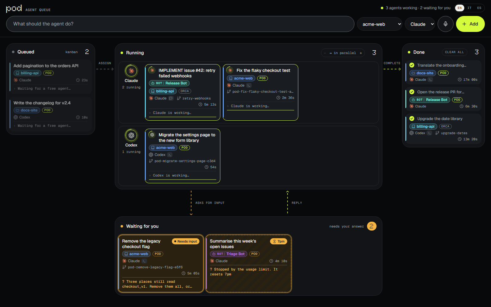
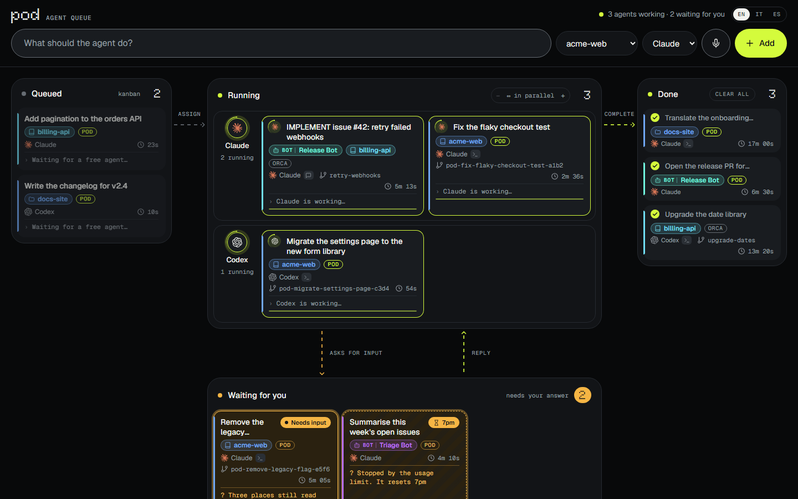
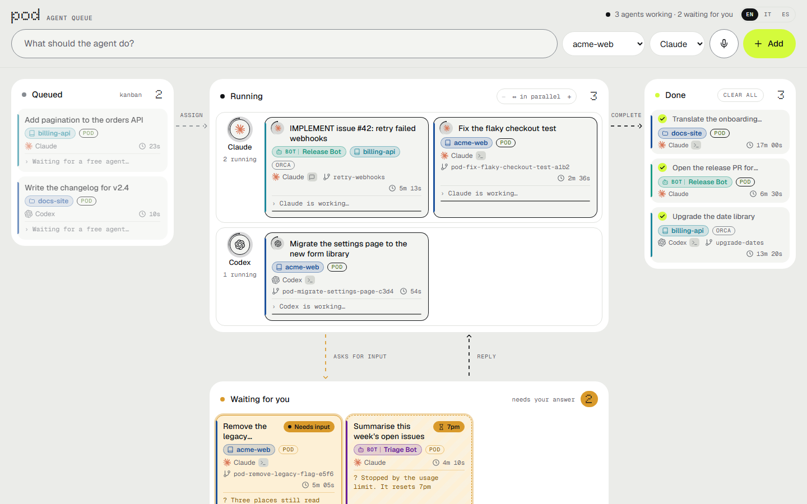
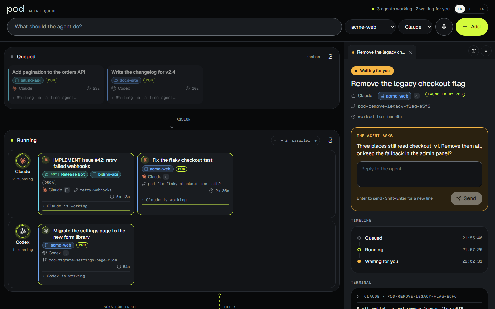

# Pod: an agent queue for Orca

Type or dictate a task, pick where it should run, and Pod hands it to an agent. The board shows
at a glance what is **queued**, **running**, **waiting for you** and **done**, with cards that
fly between columns as the agents work.



## What it does

- **Queue tasks for agents.** Pick a target and an agent (Claude or Codex):
  - a **Git project**: Pod creates a fresh worktree `pod-<task>` and starts the agent there;
  - a **folder**: the agent starts in that folder's workspace;
  - a **bot**: the task goes to the bot's Home Chat as mail (`orca orchestration send --to bot:<name>`).
- **See every agent, not only Pod's.** Agents you start in Orca directly show up too (tagged
  `ORCA`; Pod's own are `POD`). A bot's workers are tagged with the bot that started them.
- **Know where each one runs.** Every project, folder and bot has its own colour, a chip on the
  card and a stripe on its edge; an icon tells a chat session from a CLI in a terminal.
- **Waiting for you means waiting for you.** Questions and permission prompts move a card to
  *Waiting for you* with a desktop notification. An agent stopped by its **usage limit** waits
  there too, with an hourglass and the reset time, instead of looking done.
- **Answer without leaving the board.** Ctrl+Click a card for its detail: the agent's question,
  a reply box (Enter sends, Shift+Enter for a new line), the timeline and the live terminal.
  A plain click takes you to the agent in Orca.
- **Parallel limit** (none by default), set from the board's `−` / `+` or in Settings.
- **English, Italian, Spanish**, switchable from the header.
- A status bar item (`pod · 2 running · 1 waiting for you`); click it to jump to the first agent
  that waits for you.

| Dark | Light |
| --- | --- |
|  |  |



## Install

From Orca's plugin directory, or:

```sh
orca plugin install mrksoftware/orca-pod
```

Pod runs code, so Orca asks you to approve what it may do: read your projects, workspaces and
terminals; create worktrees and start agents; type your replies into an agent's terminal; open
workspaces and terminals; show notifications; keep its own storage and settings. To reach a bot's
chat it runs the `orca` CLI, from a quiet terminal titled "Pod" that it opens once in that bot's
workspace (Orca only accepts mail from a terminal).

## Settings

Settings → Plugins → Pod: language, default agent, agents in parallel (0 = no limit), whether to
show agents opened in Orca, how many done tasks stay on the board.

## How it works

| Part | Files | |
| --- | --- | --- |
| Worker | `src/worker.ts`, `src/messages.ts` | Keeps the queue in plugin storage, launches agents, follows `agent.status.changed`, reads replies with `orca agent list`, mails bots, updates the status bar |
| Panel | `src/panel.html`, `panel.css`, `panel.js`, `i18n.js` | The animated board (FLIP moves, pipes, counters), composer with dictation, detail tabs |
| Contract | `src/protocol.ts` | Types of the panel ↔ worker requests |

## Develop

```sh
orca plugin validate .
orca plugin test .                   # worker tests (src/worker.test.ts)
npx -p typescript tsc -p . --noEmit
orca plugin dev watch . --json       # load this folder into Orca and reload on save
```

## Known limits

- Dictation uses the frame's Web Speech API, which may be unavailable inside Orca; type instead.
- Pod cannot read or answer an agent that runs as a **chat** (not a terminal) unless it is a bot:
  click its card to open it in Orca.
- Usage-limit detection reads the agent's own messages ("usage limit reached", "resets 7pm").

## Credits

- Fonts: [Doto](https://github.com/oliverlalan/Doto), [Geist and Geist Mono](https://github.com/vercel/geist-font),
  SIL Open Font License 1.1 (`src/fonts/OFL.txt`).
- Claude and OpenAI logos from [simple-icons](https://simpleicons.org) (CC0). The marks belong to
  their owners and only identify which agent a card runs.

Code: MIT, see `LICENSE`.
